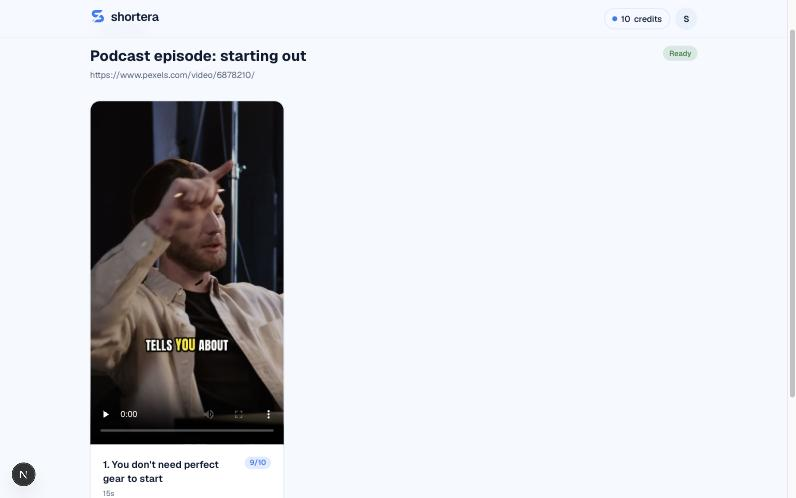
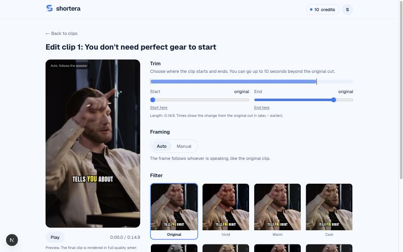
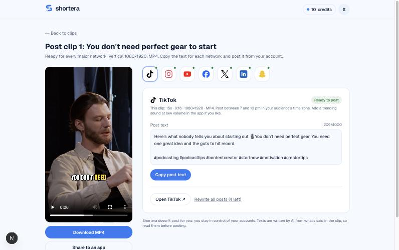

# Shortera

**Turn long videos into ready-to-post shorts with AI.**

Paste a YouTube link or upload a video. Shortera finds the best moments, frames whoever is speaking in 9:16 and adds word-by-word captions. You get vertical clips for TikTok, Instagram Reels, YouTube Shorts and more, in minutes.

### [👉 Try it at getshortera.com](https://getshortera.com)

---

## How it works

1. **Add a video.** Paste a link (YouTube, Twitch, Kick, Vimeo) or upload a file. Videos up to 3 hours.
2. **AI picks the moments.** Shortera reads the whole transcript and cuts 3 to 10 clips that stand on their own, from 15 to 60 seconds each, each one scored for how well it can do.
3. **Download and post.** Each clip is a 1080×1920 MP4 with captions burned in, plus a ready-made caption and hashtags for each network.

## Features

- 🎯 **AI moment finder.** Picks complete moments with a hook, not random cuts.
- 🗣️ **Word-by-word captions.** Bold, readable subtitles that highlight each word as it's said.
- 🎥 **Auto-framing.** The 9:16 frame follows whoever is speaking.
- ✂️ **Free clip editor.** Trim (up to 10 s beyond the original cut), reframe manually with zoom, and apply filters (Vivid, Warm, Cool and more). No extra credits.
- 📱 **Ready for every network.** TikTok, Instagram, YouTube Shorts, Facebook, X, LinkedIn and Snapchat, with post text written for each one. You post from your own accounts, so you stay in control.
- 💸 **Fair billing.** You pay for the minutes of video you add, not per clip. Failed videos are refunded automatically.

## Screenshots

| Your clips | Clip editor | Post to any network |
|:---:|:---:|:---:|
|  |  |  |

## Pricing

**1 credit = 1 minute of video**, charged by the second. Plan credits roll over, and pack credits never expire. Your first purchase comes with 20 to 150 bonus credits.

### Plans (best price per hour of video)

| Plan | Monthly | Per hour of video | Yearly (save 25%) | Per hour of video |
|---|---|---|---|---|
| **Basic** · 120 credits/month | $15 | **$7.50** | $135 | **$5.63** |
| **Creator** · 400 credits/month | $35 | **$5.25** | $315 | **$3.94** |
| **Pro** · 1,200 credits/month | $85 | **$4.25** | $765 | **$3.19** |

### One-time packs (no subscription)

| Pack | Price | Per hour of video |
|---|---|---|
| **Starter** · 60 credits | $12 | **$12.00** |
| **Creator** · 300 credits | $35 | **$7.00** |
| **Pro** · 1,000 credits | $95 | **$5.70** |

Prices in USD. In the euro area they are shown in euros, VAT included. Secure payment by Stripe. [See all prices →](https://getshortera.com/#pricing)

## FAQ

**Who is it for?**
Podcasters, streamers, YouTubers, coaches and agencies who want to post short videos every day without editing them by hand.

**Does Shortera post for me?**
No. You download the clips (or share them straight to an app) and post from your own accounts. Shortera writes the post text for each network so it only takes a few seconds.

**What if a video fails?**
The credits for that video go back to your balance automatically.

**Can I cancel my plan?**
Yes, anytime, from "Manage plan". You keep access until the end of the period you paid for.

**Is there a referral program?**
Yes. Share your link: your friend gets +10 credits on their first purchase and you get 60 credits.

## Get started

**[getshortera.com](https://getshortera.com)** · Questions or feedback: [support@getshortera.com](mailto:support@getshortera.com)

---

This repository is a public showcase of Shortera. The app itself is a hosted service and its source code is private. Demo footage from <a href="https://www.pexels.com">Pexels</a>.
